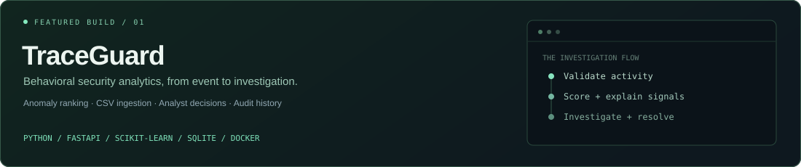
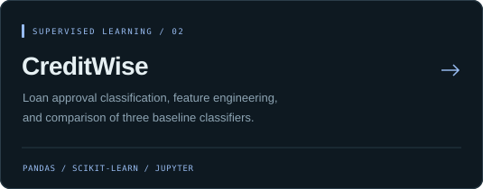

  

  <a href="#about">About</a> &nbsp; · &nbsp;
  <a href="#selected-work">Selected work</a> &nbsp; · &nbsp;
  <a href="#working-toolkit">Toolkit</a> &nbsp; · &nbsp;
  <a href="#contribution-activity">Contribution activity</a>

## About

I'm **Tanush**, a **Mathematics and Computing undergraduate at Delhi Technological University**, working toward opportunities in Python, machine learning, and software engineering.

I enjoy connecting mathematical ideas with practical applications—especially behavioral analysis, cybersecurity, and data-driven systems. Alongside projects, I practice data structures and algorithms in C++.

**My focus:** understand the model, build the surrounding software, and explain its limitations clearly.

## Selected work

**Start with [TraceGuard →](https://github.com/tanush78/TraceGuard)** &nbsp; [Dashboard preview](https://github.com/tanush78/TraceGuard/blob/main/docs/dashboard.png) · [Design and tradeoffs](https://github.com/tanush78/TraceGuard/blob/main/docs/INTERVIEW.md)

A working analyst flow: import events, inspect contextual signals, record decisions, and retain an audit history. Includes API tests, browser checks, Docker setup, and a reproducible **synthetic** evaluation; it is a local prototype, not a production intrusion-detection claim.

<table>
  <tr>
    <td width="50%"></td>
    <td width="50%"></td>
  </tr>
</table>

**Also exploring:** [SnapClass](https://github.com/tanush78/SnapClass), a course-based classroom attendance implementation with face/voice recognition, student enrollment, Streamlit, and Supabase. Original course creators remain acknowledged in the repository.

## Working toolkit

| Area | Tools used in my projects and coursework |
| :--- | :--- |
| **Languages** | Python · C++ · C · Java · SQL |
| **Machine learning** | scikit-learn · XGBoost · PyTorch · NumPy · pandas |
| **Applications & data** | FastAPI · SQLite · Streamlit · Supabase |
| **Analysis & development** | Matplotlib · Seaborn · Jupyter · Git · Docker |

**What I'm improving:** model evaluation, reproducible experiments, testable APIs, and clearer technical documentation.

## Contribution activity

<picture>
  <source media="(prefers-color-scheme: dark)" srcset="https://raw.githubusercontent.com/tanush78/tanush78/contribution-snake/github-contribution-grid-snake-dark.svg">
  <source media="(prefers-color-scheme: light)" srcset="https://raw.githubusercontent.com/tanush78/tanush78/contribution-snake/github-contribution-grid-snake.svg">
  
</picture>

Generated from my GitHub contribution graph and refreshed daily. Learning in public, one useful project at a time.
